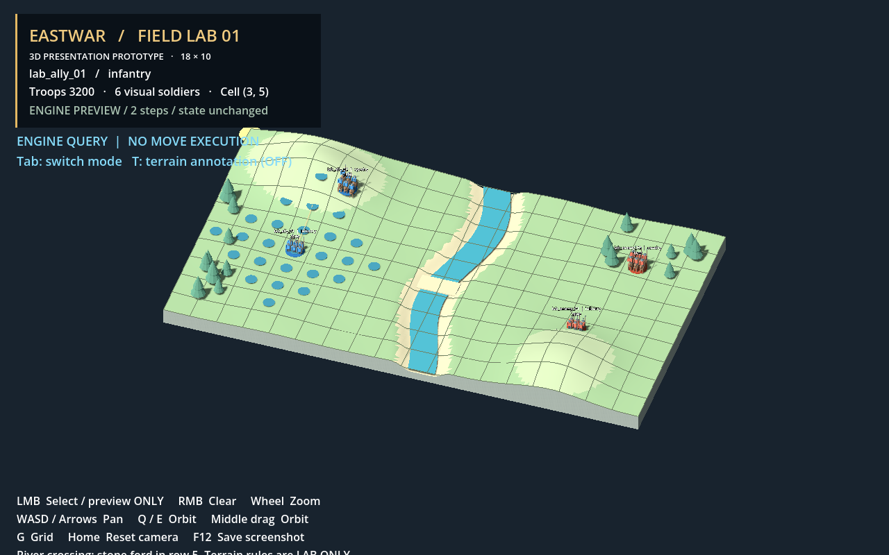
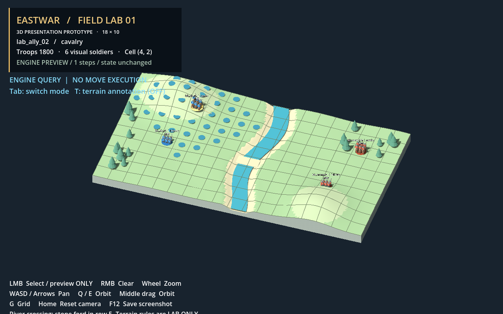

# BATTLE3D C-0–C-3: read-only movement query connection

## Result and boundary

The separate `Battle3D_EngineConnectLab.tscn` displays movement ranges and ordered
path previews returned by the existing `BattleMovementQueryService`. It does not
commit movement, execute turns/attacks, enter WorldMap, or modify production files.
The original standalone 18×10 Lab remains unchanged.

- Base: `f8b56c3de0e05c33c620d32e021f4b466f40a984` (verified commit object).
- Branch: `feature/battle3d-engine-connect-20261019`.
- Remote integration branch observed at `8b7f3ca9a34be8a103e9dc190db9bc4cb7dc03aa`.
  Comparison with the base contains only three documentation changes.
- Independent checkout, no push, no merge. Use `git rev-parse HEAD` for this local
  result commit; this document is part of that commit.
- Local scoped Level 2 validation. No GitHub Actions success is claimed.

## Implementation

- `scripts/battle3d/battle3d_unit_adapter.gd`: copies all specified presentation
  fields, including a deep copy of status effects. `move_range` and `attack_range`
  are read-only outputs. Reverse conversion creates fixtures through unmodified
  `BattleUnitState.create/setup`; input range overrides are discarded.
- `battle3d_grid_projection.gd`: inherits bounds, distance and logical range methods
  unchanged. Uses the exported terrain/ford collision meshes for ray picking.
  Jolt missed a ray exactly on one terrain vertex; a same-ray, sampled-heightfield
  intersection fallback handles misses using the same triangle-height interpolation
  and ford surface. No plane projection, ray displacement or engine rule change.
- `battle3d_movement_adapter.gd`: resolves the authoritative unit by ID, projects
  its view data, then calls the existing service with the original state objects
  and inherited grid. Live queries never round-trip through fixture creation.
- `battle3d_connect_lab.gd`: defaults to query mode. Blue markers show reachable
  cells; the light path is a preview. Its samples follow the terrain surface.
- `terrain_rules_enabled` defaults to false; toggling it only adds river annotation
  markers. The flag is not consumed by the engine adapter or passed to its service.
  Demo-only BFS retains its original terrain rules in `lab_demo_port.gd`.
- Tab switches modes. Every switch cancels frame-driven demo motion, clears
  selection/overlays, and restores all visual/demo positions from engine state.
  Query mode never moves the units. The original Lab rendering helpers and assets
  were copied to namespaced paths, not moved from the standalone project.

## Verification on the reported source

| Check | Result |
|---|---|
| New movement parity | **PASS: 66,132 checks, 0 failures** |
| Scenarios | 15: five unit types, allied/enemy blockers with breakthrough off/on, four edge/corner cases, mobility up/down, zero budget, enclosed mover |
| Adapter vs direct service | Reachable key sets and ordered paths, target paths, destination validity, effective budgets and preview eligibility |
| State preservation | All script-variable fields of every input state unchanged after each scenario; presentation dictionaries isolated |
| Ray round trips | **540/540**: 180 cells at three overhead zoom settings |
| Occlusion | Two distinct low-angle viewpoints; first visible cell checked against independent dense surface sampling |
| Ray misses | Outside-terrain and zero-direction cases rejected |
| Mode lifecycle | **PASS: 20 checks, 0 failures**, including interruption mid-demo, restoration, highlights and terrain-flag isolation |
| Existing movement regression | **PASS: 30 checks, 0 failures**, with baseline teardown warnings described below |
| Existing combat regression | **PASS: 29 checks, 0 failures**, with baseline teardown warnings described below |
| Existing static validators | B-1B movement, B-1C combat and WorldMap main integrity: PASS |
| New static validators | Contract/resource guard and new-files-only scope guard: PASS |
| Import and rendering | Godot 4.6.2, actual Compatibility/OpenGL rendering on GTX 1660; two screenshots inspected |

The zero-budget fixture uses an unsupported test-only unit type whose normal
`UnitTypeContract` lookup returns zero, plus `movement_down`, to exercise the clamp.
No test overwrites move range after setup.

### Baseline warnings, not hidden passes

Both existing regression scripts print their PASS summaries but also report
`ObjectDB instances leaked at exit` and `2 resources still in use at exit`.
They were rerun in an untouched remote checkout at `8b7f3ca`, whose engine and test
files match the base, and produced the same warnings. New parity/mode tests have
no such errors. Production/test teardown was not changed to hide these warnings.
This is not an error-free full-project checkpoint.

Final local evidence in the sibling `EASTWAR_C0C3_Evidence` directory:
`parity_v3.log`, `modes_verified.log`, `render_verified.log`, `import_final.log`,
`regression_movement.log`, `regression_combat.log`, `baseline_movement.log`,
`baseline_combat.log`, and final static/scope outputs. Earlier failure logs are
retained separately and are not the final validation result.

## Screenshots





## Reproduce and operate

From the checkout root, with Godot and Python available:

```text
godot --headless --editor --path . --import
godot --headless --path . --script res://tests/scripts/test_battle3d_movement_parity.gd
godot --headless --path . --script res://tests/scripts/test_battle3d_modes.gd
python tools/validate_battle3d_contract.py
python tools/validate_battle3d_scope_guard.py
godot --path . --rendering-method gl_compatibility --resolution 1280x800 res://scenes/battle3d/Battle3D_EngineConnectLab.tscn
```

Left click an ally, then a destination to preview. Tab switches query/demo modes;
T toggles terrain annotations. Wheel zooms, WASD pans, Q/E rotates, Home resets.
The window title is `EASTWAR | Engine Query C0-C3 (18x10)`.
`-- --capture-connect` captures two engine range previews and exits.

## Remaining scope

Fixtures use real engine state classes and movement rules, not a live battle session.
Turn/action eligibility is not added to the pure movement query service. This
milestone proves read-only movement-query/view parity, not complete combat parity.
No Battle_Main/WorldMap loads occur in the new tests. Existing regression scripts
retain their own controller fixtures. Independent reviewer gates have not been
claimed completed and no message was sent to another agent or external service.
